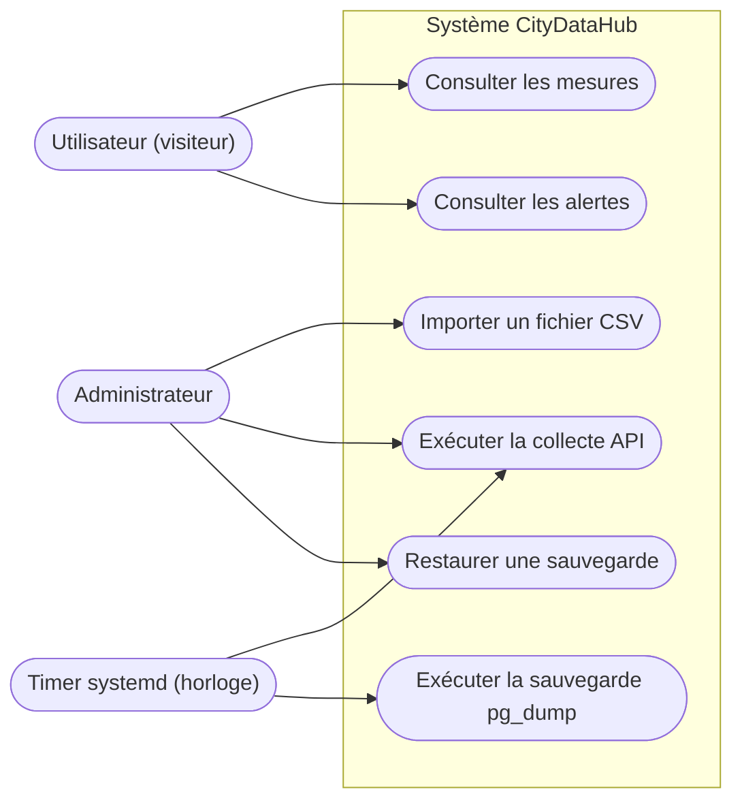
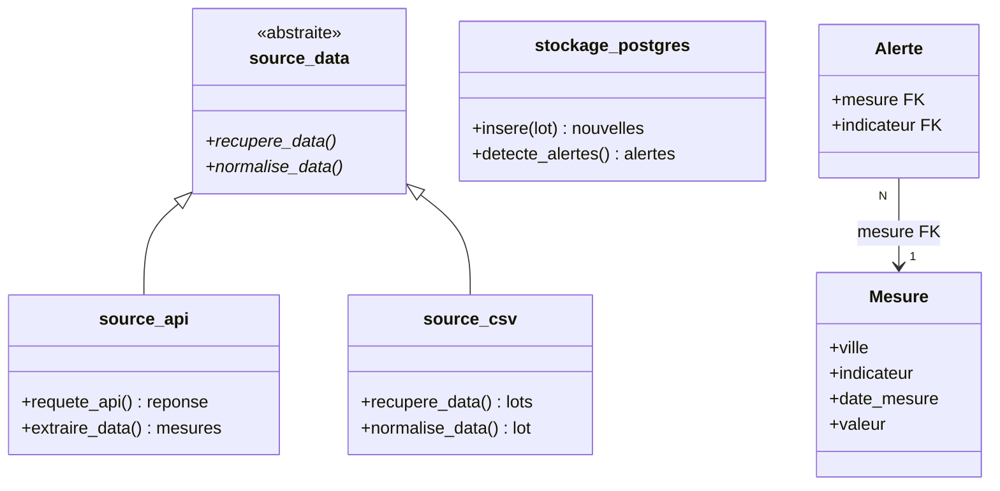
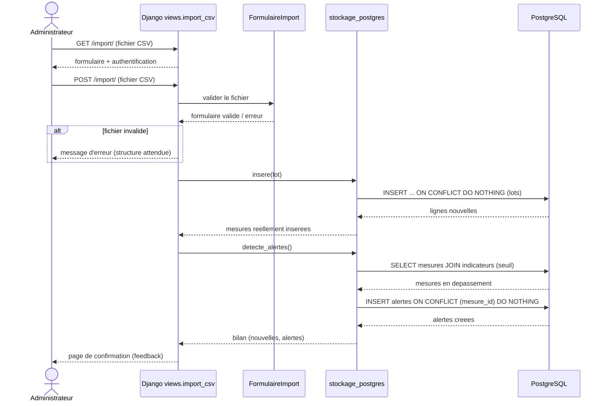
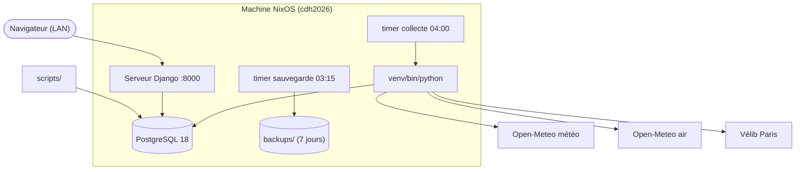

# CityDataHub — vitrine de données urbaines

Pipeline de collecte, d'alerte et de consultation de données de ville
(météo, qualité de l'air, vélos) : APIs publiques et CSV vers PostgreSQL,
détection d'alertes de seuil, interface web Django, sauvegardes vérifiées
et planification systemd — le tout sur NixOS.


Auteur : Eric Diologeant — Projet NixOS (`cdh2026`), novembre 2026

## Sommaire

1. [Architecture](#architecture)
2. [Installation](#installation)
3. [Usage](#usage)
4. [Fonctionnement quotidien](#fonctionnement-quotidien)
5. [Tests](#tests)
6. [Sécurité](#sécurité)
7. [Licence](#licence)

## Architecture

Trois diagrammes suffisent : qui utilise le système, comment le code
est organisé, et sur quoi tout tourne. Les versions complètes (noms
exacts, exceptions, détail des composants) sont dans `docs/uml/`,
en Mermaid et en PlantUML.

### Cas d'utilisation

Trois acteurs : le visiteur consulte, l'administrateur en plus déclenche
les opérations réservées (import CSV derrière l'authentification,
collecte, restauration), et le timer systemd joue tout seul la collecte
et la sauvegarde planifiées — personne n'a besoin d'être présent pour
que le système vive.



### Classes

À gauche le moteur Python (sources API/CSV vers une classe abstraite
commune, stockage PostgreSQL, analyse) ; à droite les modèles Django —
la table de faits `Mesure` et ses référentiels, les alertes reliées par
clés étrangères.



### Séquence — l'import CSV de bout en bout

L'administrateur envoie le fichier ; Django valide la structure,
insère par lots sans jamais dupliquer, déclare les alertes de seuil,
et rend un feedback chiffré.



### Déploiement

Toute l'architecture tient sur une machine, pilotée par systemd :
à 03:15 elle s'archive, à 04:00 elle collecte depuis trois APIs
publiques vers PostgreSQL, Django sert le LAN sur le port 8000, et
`backups/` garde sept jours d'histoire. Si la machine dort,
`Persistent` rattrape le retard au démarrage.



## Installation

Tout tourne sur une machine NixOS : PostgreSQL, les timers et le
pare-feu sont déclarés dans la configuration du système, le reste
du projet est un dépôt Python classique.

### Prérequis

- NixOS 26.05 (machine de référence : `cdh2026`)
- PostgreSQL 18 (paquet `postgresql_18` déclaré dans la config système)
- Python 3.x avec `venv`
- Connexion Internet pour les APIs publiques

### Base de données

La base et les droits sont créés une seule fois :

```bash
sudo -u postgres psql -c "CREATE ROLE ericd LOGIN;"            # si absent
sudo -u postgres createdb citydatahub -O ericd
```

Ensuite, trois fichiers rejouables (`IF NOT EXISTS` / `ON CONFLICT`
partout, l'ordre importe) :

```bash
psql -d citydatahub -f sql/schema.sql          # tables, index, contraintes
psql -d citydatahub -f sql/referentiels.sql    # catégories, indicateurs, sources
psql -d citydatahub -f sql/alertes.sql         # détection de seuil (idempotente)
```

Deux remarques de conception : `sql/reinitialisation.sql` remet la base à
l'état connu (réinitialisation complète, pour tests et démo), et
`sql/alertes.sql` se rejoue après chaque import — c'est lui qui garantit
qu'une mesure au-dessus du seuil produit exactement une alerte, jamais
deux. Les tables sont créées par le SQL, Django les lit telles quelles :
aucune migration, jamais de `manage.py migrate`.

### Projet Python

```bash
git clone https://github.com/ExpertAsAService/citydatahub
cd citydatahub
python3 -m venv venv
source venv/bin/activate
pip install -r requirements.txt
```

### Serveur web

```bash
python manage.py runserver 0.0.0.0:8000   # accessible sur le LAN
```

### Planification (NixOS)

Les timers systemd (collecte 04:00, sauvegarde 03:15, rattrapage
`Persistent`) sont déclarés dans `nixos/citydatahub.nix`, importé
depuis `/etc/nixos/configuration.nix` :

```bash
sudo nixos-rebuild switch
systemctl list-timers citydatahub-*
```

## Usage

### Démo complète (une commande)

```bash
bash scripts/demo.sh
```

Schéma, référentiels, collecte des quatre sources API, import CSV,
contenu de la base, 47 tests, et les rappels du serveur web — tout
l'enchaîné en une seule entrée.

### Sauvegardes (contre-épreuve incluse)

```bash
bash scripts/sauvegarde.sh          # dump -Fc daté, rotation 7 jours
bash scripts/verif_sauvegarde.sh    # restaure le dernier dump dans une
                                    # base jetable, compare les comptages,
                                    # rend un verdict, puis supprime
bash scripts/restore_sauvegarde.sh # restauration SUR la production :
                                    # double confirmation + dump de sécurité
```

Chaque script vit seul ou presque : la sauvegarde quotidienne à 03:15
est assurée par le timer systemd, la vérification est lisible à l'œil
nu dans les journaux.

### Serveur web

```bash
python manage.py runserver 0.0.0.0:8000
```

Accueil : mesures par ville et alertes actives ; collecte et import
de fichiers CSV via formulaires, derrière l'authentification admin
(les choix de collecte dérivent du registre réel des sources :
impossible de sélectionner une source inexistante) ; API JSON :
`/api/mesures/<indicateur>`.

### Tests

```bash
pytest tests/
```

## Fonctionnement quotidien

Le système vit seul. Chaque nuit, à 03:15, le timer systemd exécute
la sauvegarde (dump compressé daté, rotation à 7 jours) ; à 04:00,
le pipeline collecte les quatre sources, insère les nouveautés sans
jamais dupliquer (contrainte SQL d'unicité) et déclenche la détection
d'alertes. Si la machine dormait, `Persistent` rattrape le retard au
démarrage suivant. Chaque exécution rend un bilan par source dans le
journal (`journalctl -u citydatahub-pipeline`), et le service échoue
proprement (`exit 1`) si une source est en panne.

La vérification de sauvegarde s'exécute à la main :
`bash scripts/verif_sauvegarde.sh` restaure le dernier dump dans une
base jetable, compare les comptages avec la production et rend un
verdict en une ligne.

## Tests

```bash
pytest tests/
```

47 tests : extracteurs, sources API et CSV, stockage et idempotence,
analyseur, indicateur, pipeline, vues Django, API JSON, intégration
PostgreSQL (schéma rejouable, unicité des mesures, clés étrangères
exécutoires, détection idempotente). Les tests d'intégration ne
touchent jamais la production : ils s'exécutent sur une base éphémère
recréée à chaque session.

## Sécurité

Le détail complet de chaque mesure est dans le document Sécurité
(canvas compagnon / `docs/SECURITE.md` dans le dépôt).

- Les tests et l'intégration continue ne touchent **jamais** la base
  de production : tout s'exécute sur la base éphémère `citydatahub_test`,
  recréée à chaque session.
- L'intégrité des données est exécutoire au niveau SQL : unicité
  `(ville, indicateur, date)`, clés étrangères réelles sur les alertes,
  jamais contournables par l'application.
- Aucun secret n'est commis au dépôt : les accès à la base sont locaux,
  la publication Git se fait par SSH (clé privée protégée par passephrase).
- Le pare-feu NixOS n'ouvre que le port 8000, sur le réseau local.
- Sauvegardes compressées natives (`pg_dump -Fc`), rotation 7 jours,
  vérifiées par contre-épreuve (comptages comparés table par table).

## Licence

MIT — Eric Diologeant, 2026.