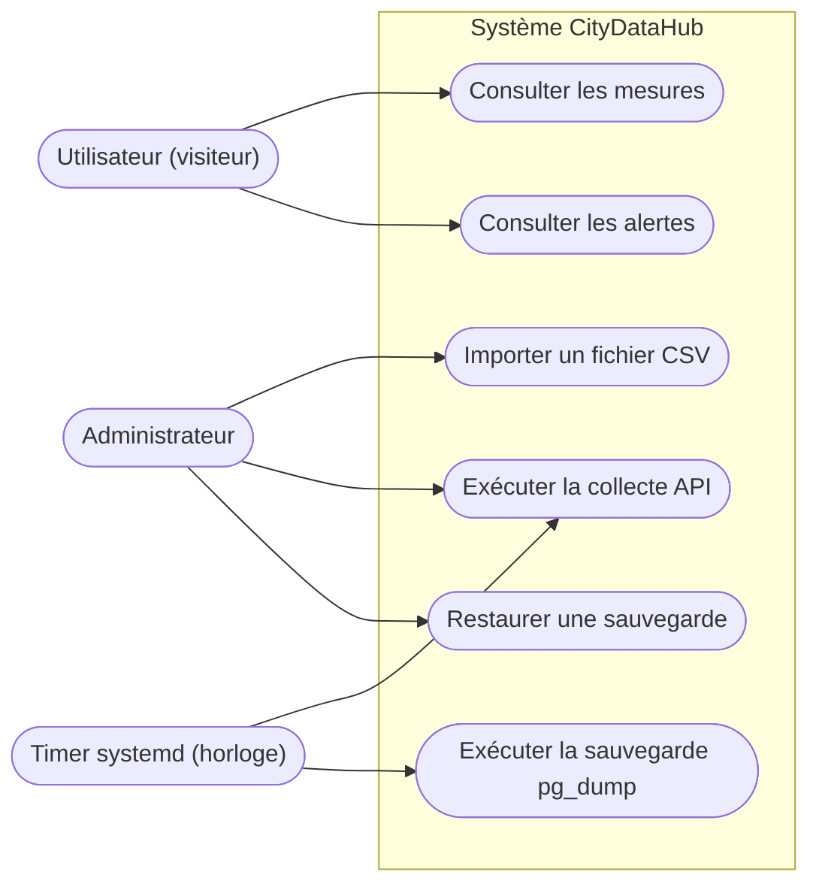
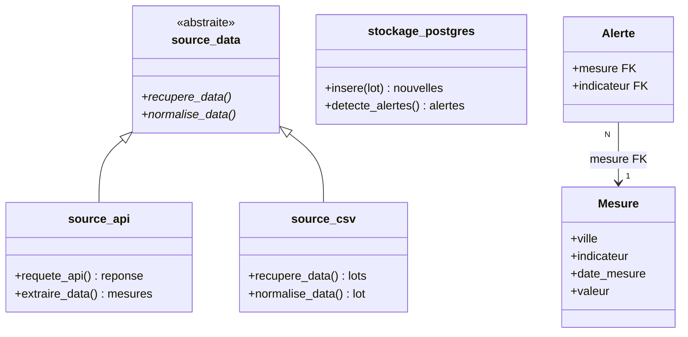
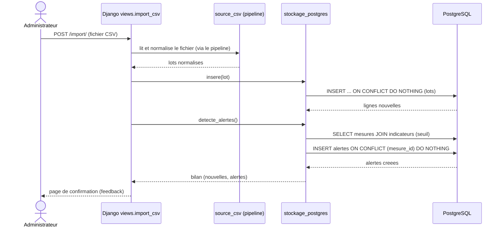
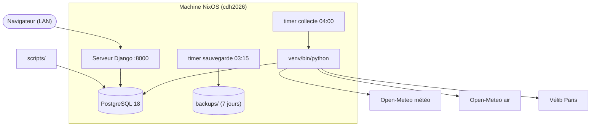

**Projet d'agrégation et de valorisation de données urbaines ouvertes**

Candidat : Eric Diologeant — Novembre 2026
Machine de référence : `cdh2026` (VM NixOS 26.05 — 1 processeur / 4 cœurs, 8 Go RAM, 60 Go disque)
Pile : Python 3.14 (venv), PostgreSQL 18, Django 6.1, systemd, Git versionné sur GitHub

---

## 1. Présentation du projet

CityDataHub est un système d'agrégation de données urbaines publiques : il collecte chaque nuit, sans intervention humaine, des données météorologiques, de qualité de l'air et de disponibilité de vélos (APIs publiques Open-Meteo et Vélib), complétées par des imports de fichiers CSV. Les mesures sont stockées dans PostgreSQL sans jamais être dupliquées, comparées automatiquement aux seuils de référence, publiées sous forme d'alertes, puis servies en pages web et en API JSON.

L'ensemble de l'infrastructure (serveur PostgreSQL, pare-feu, services et timers systemd, schéma de base) est décrit de façon déclarative dans la configuration NixOS, versionnée avec le projet : l'environnement est reproductible à partir du seul dépôt Git.

**Chiffres clés** :

| Indicateur | Valeur |
|---|---|
| Mesures stockées | 2 401 037 |
| Alertes générées | 491 294 |
| Sources API intégrées | 4 |
| Tests automatisés | 47, exécutés en 5,5 s |
| Sauvegarde vérifiée | 21 Mo, contre-épreuve chaque nuit |
| Débit d'import | ~24 000 lignes/s, mémoire constante |

## 2. Objectifs et cahier des charges

Le projet répond aux exigences d'un cahier des charges professionnel complet :

- **Collecter** depuis des sources hétérogènes (APIs REST publiques et fichiers CSV) avec un traitement par lots garantissant une mémoire constante, quel que soit le volume ;
- **Stocker** dans PostgreSQL avec intégrité exécutoire : unicité des mesures, clés étrangères réelles, opérations relançables plusieurs fois sans effet de bord (idempotence) ;
- **Détecter** automatiquement les dépassements de seuils et produire des alertes, sans doublon ;
- **Publier** : pages web consultables et API JSON, avec accès administrateur restreint pour la collecte et l'import ;
- **Exploiter** : collecte planifiée nocturne, sauvegarde quotidienne vérifiée, restauration contrôlée — scripts d'exploitation documentés ;
- **Documenter** : installation, exploitation et sécurité écrites (`README.md`, `docs/`), schémas UML (cas d'utilisation, classes, séquence, déploiement), tests.

## 3. Architecture

### Cas d'utilisation

Trois acteurs : le visiteur consulte les mesures et les alertes ; l'administrateur authentifié déclenche en outre l'import CSV, la collecte manuelle et la restauration ; le timer systemd exécute seul la collecte et la sauvegarde planifiées.

### Classes — organisation du code

Le moteur Python repose sur une classe abstraite `source_data` dont héritent `source_api` et `source_csv` : tout type de source garantit la récupération par générateur de lots et la normalisation vers un format unique. Le stockage PostgreSQL (`stockage_postgres`) implémente l'insertion par lots et la détection d'alertes ; le pipeline orchestre l'ensemble et isole chaque source par une exception dédiée. Côté web, les modèles Django reflètent la table de faits `Mesure` et ses référentiels.

### Séquence — l'import CSV de bout en bout

L'administrateur envoie le fichier ; Django valide la structure, insère par lots sans duplication (`ON CONFLICT DO NOTHING`), déclenche la détection des alertes selon les seuils du référentiel, et rend un bilan chiffré.

### Déploiement

Toute l'architecture tient sur une machine pilotée par systemd : la sauvegarde s'exécute à 03:15, la collecte des sources à 04:00, Django sert le réseau local sur le port 8000, et `backups/` conserve sept jours d'historique. Si la machine était arrêtée à l'heure prévue, l'option `Persistent` des timers déclenche le rattrapage au prochain démarrage.

## 4. Dispositif de collecte et traitement

**Sources gérées** : quatre indicateurs via APIs publiques (météo et qualité de l'air Open-Meteo, disponibilité Vélib) et des fichiers CSV importés par l'administrateur. Toute source suit le même contrat (héritage de `source_data`) :

- récupération **par générateur de lots** de 10 000 lignes : la mémoire nécessaire est celle d'un lot, indépendante du volume total ;
- **normalisation stricte** : dates converties en timestamps, valeurs converties en nombres, noms nettoyés — un seul format de sortie pour toute source ;
- lignes invalides supprimées à la normalisation, avec bilan par lot (une ligne fausse n'interrompt pas un fichier) ;
- chaque source est isolée du point de vue des erreurs : une source indisponible est journalisée, les autres sources continuent, le code de sortie rend compte de l'échec.

**Stockage et intégrité** : insertion par `INSERT ... ON CONFLICT DO NOTHING` sur la clé unique `(ville, indicateur, date)`, ce qui garantit qu'aucune mesure n'est dupliquée même après relance ; détection d'alertes idempotente (une alerte par mesure au plus, contrainte d'unicité dédiée) ; clés étrangères réelles reliant alertes, mesures et référentiels.

## 5. Application web

- **Pages publiques** : accueil avec état du système, mesures, alertes, pages par indicateur avec graphiques (Chart.js) ;
- **Pages administrateur** (authentification Django) : import de fichiers CSV, déclenchement de la collecte, administration du référentiel et des seuils ; chaque import est historisé dans une table dédiée ;
- **API JSON** : accès aux mesures, avec bornes de taille de réponse et validation des paramètres.

Le schéma de base est défini et versionné en SQL : Django lit les tables telles quelles, le SQL reste l'unique propriétaire de la structure (choix d'auditabilité).

## 6. Sécurité

1. **Intégrité exécutoire au niveau SQL** : unicité `(ville, indicateur, date)`, clés étrangères réelles sur les alertes, contraintes non contournables par l'application ;
2. **Séparation des environnements** : les tests et les démonstrations d'intégration s'exécutent exclusivement sur une base dédiée (`citydatahub_test`), jamais sur la base de production ;
3. **Aucun secret dans le dépôt** : publication Git par SSH, clé privée protégée par passephrase, accès base locaux uniquement (PostgreSQL n'écoute pas sur le réseau) ;
4. **Barrières sur les opérations destructrices** : confirmation explicite pour toute restauration, dump de sécurité préalable, verdict automatique par comparaison de comptages après opération ;
5. **Protections web standard** : requêtes SQL paramétrées exclusivement (aucune concaténation), échappement automatique des templates Django et sérialisation sécurisée pour les graphiques, protection CSRF active sur tous les formulaires (seule l'API en lecture seule en est exemptée, sans effet de bord possible), authentification requise pour toute opération d'écriture ;
6. **Pare-feu** : seul le port 8000 est ouvert sur le réseau local.

Le détail figure dans `docs/SECURITE.md` (dix sections, limites comprises).

## 7. Exploitation et continuité

Cinq scripts documentés dans `scripts/` :

- `sauvegarde.sh` : dump compressé horodaté, rotation automatique sept jours ;
- `verif_sauvegarde.sh` : contre-épreuve quotidienne — restauration du dernier dump dans une base jetable, comparaison des comptages table par table avec la production, verdict en une ligne ;
- `restore_sauvegarde.sh` : restauration contrôlée sur la production (confirmation saisie, dump de sécurité de l'état courant, comparaison des comptages après opération) ;
- `demo.sh` : démonstration reproductible du cycle complet (schéma, référentiels, seuils, collecte, import, bilan SQL, tests, service web) ;
- `demo_integration.sh` : preuve des cinq propriétés structurelles sur la base de test (réinitialisation à un état connu, rejeu du schéma, unicité, rejet des clés étrangères orphelines, idempotence de la détection).

**Preuves d'exploitation** : collecte nocturne exécutée sans intervention, rattrapage automatique après extinction de la machine, restauration vérifiée au comptage près (2 401 035 mesures, 491 294 alertes, comptages identiques entre production et base restaurée).

## 8. Tests et qualité

- 47 tests automatisés exécutés en 5,5 s, couvrant modules de collecte, stockage, normalisation, détection d'alertes, vues Django et propriétés d'intégration PostgreSQL ;
- tests d'intégration prouvant les propriétés de la base : rejeu du schéma sans erreur, absorption des doublons, rejet par clé étrangère, idempotence de la détection ;
- les tests ne touchent jamais la base de production (garde-fou sur le nom de la base) ;
- le mode d'exécution est décrit dans le `README.md`.

## 9. Choix techniques et justification

| Choix | Justification |
|---|---|
| NixOS (déclaratif) | L'infrastructure entière (PostgreSQL, pare-feu, services, timers) est versionnée avec le projet ; l'exploitation se relit, se rejoue et se prouve en une commande (`nixos-rebuild switch`) |
| PostgreSQL | Intégrité exécutoire (unicité, clés étrangères) ; contraintes non contournables par le code applicatif |
| Traitement par lots (générateurs) | Coût mémoire constant et indépendant du volume ; le même code tient 10 000 lignes comme 2,4 millions |
| Django sans migrations | Schéma SQL versionné et audité ; l'application lit les tables, un seul propriétaire de la structure |
| `ON CONFLICT DO NOTHING` | Idempotence : toute opération (import, collecte, détection) peut être relancée sans effet de bord |
| Un seul lecteur CSV et une seule écriture : `source_csv` pour tout CSV, `stockage_postgres` pour toute écriture | Le site appelle le pipeline, il ne le réécrit pas : import web et collecte automatique partagent le même lecteur normalisé et le même module de stockage, donc les mêmes garanties (unicité, idempotence, détection) |

## 10. Limites et perspectives

Le projet assume certaines limites actuelles, assorties de perspectives d'évolution :

- **Filtres du tableau de bord** : ajouter le filtrage par période, catégorie et source sur les pages de consultation ;
- **Notification des alertes** : les alertes sont publiées sur le site ; l'envoi (courriel ou message) est une extension naturelle au-dessus de la table existante ;
- **Stockage local** : la rotation à sept jours vit sur la machine ; la perspective est une copie hors site, chiffrée ;
- **Pas de TLS sur le LAN** : usage interne ; un reverse proxy HTTPS est prévu pour un accès distant ;
- **Analyse avancée** : un module d'analyse est développé, il reste à l'intégrer aux pages web.

## 11. Réinstallation depuis zéro

Le système se reconstruit intégralement sur une machine vierge à partir du seul dépôt Git. Le déroulé complet, commandes comprises, est documenté dans `docs/installation.md` ; les étapes principales :

1. **Créer la machine** : VM (1 processeur / 4 cœurs, 8 Go RAM, 60 Go disque, réseau NAT) et installation de NixOS — partitionnement GPT (racine ext4 + partition EFI), `nixos-generate-config`, `nixos-install` ;
2. **Déployer le système déclaré** : récupérer le dépôt, copier `nixos/configuration.nix` et `nixos/citydatahub.nix` dans `/etc/nixos/`, puis `sudo nixos-rebuild switch` — PostgreSQL 18 (bases `citydatahub` et `citydatahub_test`), services, timers et pare-feu sont installés et configurés en une commande ;
3. **Poser l'environnement applicatif** : `python -m venv venv` puis `pip install -r requirements.txt` ;
4. **Initialiser et vérifier** : `bash scripts/demo.sh` (schéma, référentiels, seuils, collecte, import, bilan SQL, tests) ;
5. **Démarrer le service web** : `./venv/bin/python manage.py runserver 0.0.0.0:8000`.

Chaque étape est idempotente et rend un verdict vérifiable (tables présentes, tests verts, pages accessibles). La couche déclarative (paquets, services, utilisateurs, réseau) est intégralement reconstruite depuis le dépôt ; seule la couche disque (partitionnement, formatage) reste procédurale — elle est documentée commande par commande dans `docs/installation.md`.

## 12. Les scripts

| Script | Rôle | Garantie rendue |
|---|---|---|
| `demo.sh` | Démonstration du cycle complet : schéma, référentiels, seuils, données de démonstration, collecte des sources API, import CSV, bilan SQL, tests, rappel du service web | Rejouable sans effet de bord : une seconde exécution laisse le plateau identique (0 insertion) |
| `demo_integration.sh` | Preuve des cinq propriétés structurelles sur la base de test : réinitialisation à un état connu, rejeu du schéma, absorption d'un doublon, rejet d'une clé étrangère orpheline, idempotence de la détection | Les propriétés d'intégrité sont prouvées par PostgreSQL lui-même, jamais sur la base de production |
| `sauvegarde.sh` | Dump compressé horodaté dans `backups/`, rotation automatique sur sept jours | Une archive par jour, l'espace disque reste borné |
| `verif_sauvegarde.sh` | Contre-épreuve : restauration du dernier dump dans une base jetable, comparaison des comptages table par table avec la production, verdict en une ligne, purge | Une sauvegarde n'est déclarée bonne qu'après avoir été restaurée et comparée |
| `restore_sauvegarde.sh` | Restauration contrôlée sur la production : confirmation saisie au clavier, dump de sécurité de l'état courant avant opération, comparaison des comptages après | L'opération destructrice ne s'exécute qu'avec double barrière et filet de sécurité |

## Annexe — références du dépôt

- Dépôt : https://github.com/ExpertAsAService/citydatahub
- `README.md` (7 sections, diagrammes intégrés) — `docs/SECURITE.md` (10 sections)
- `docs/` : `installation.md` (installation depuis zéro), `mode-operatoire.md` (procédures d'exploitation)
- `docs/uml/` : les quatre diagrammes en Mermaid + PlantUML (cas d'utilisation, classes, séquence, déploiement)
- `sql/` : `schema.sql`, `referentiels.sql`, `alertes.sql`, `reinitialisation.sql`
- `nixos/citydatahub.nix` : services et timers systemd
- `scripts/` : `demo.sh`, `demo_integration.sh`, `sauvegarde.sh`, `verif_sauvegarde.sh`, `restore_sauvegarde.sh`
